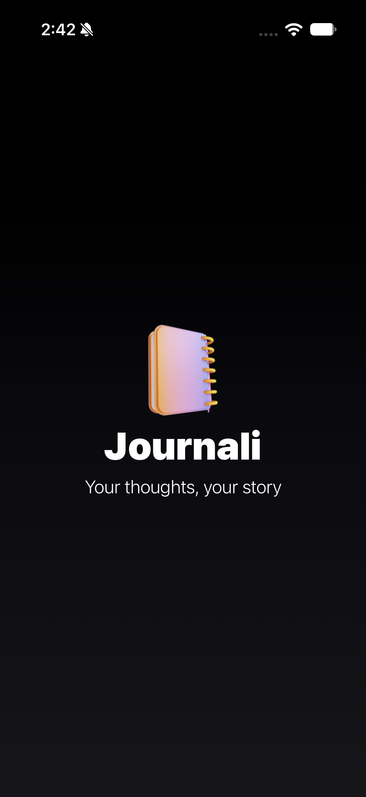
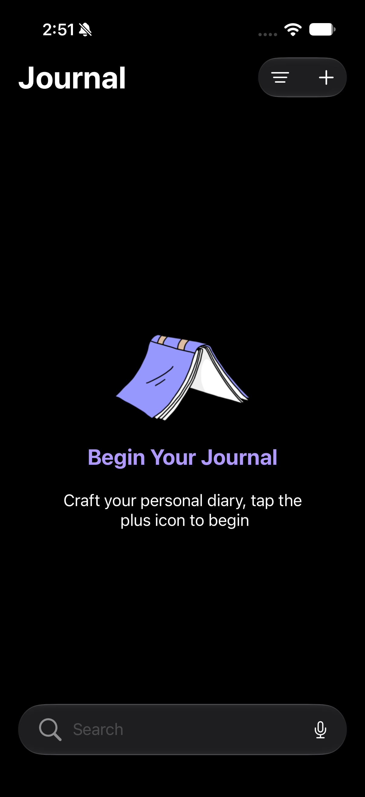
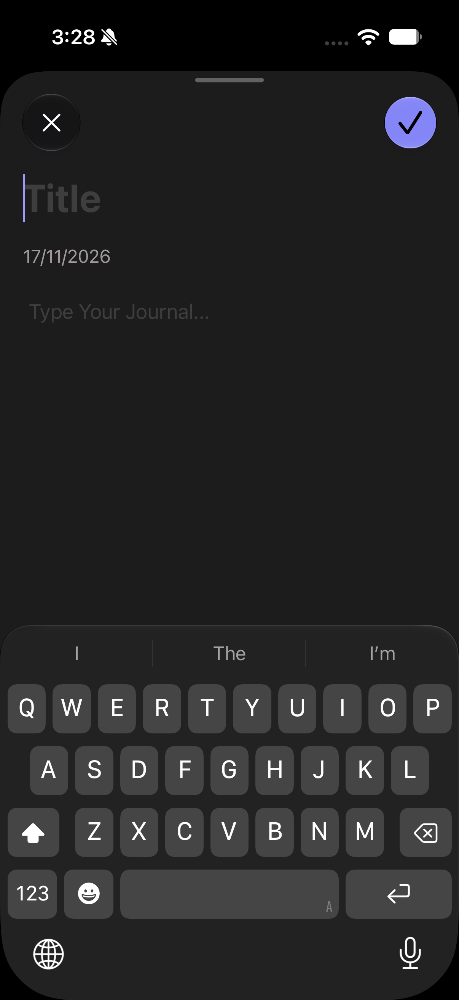
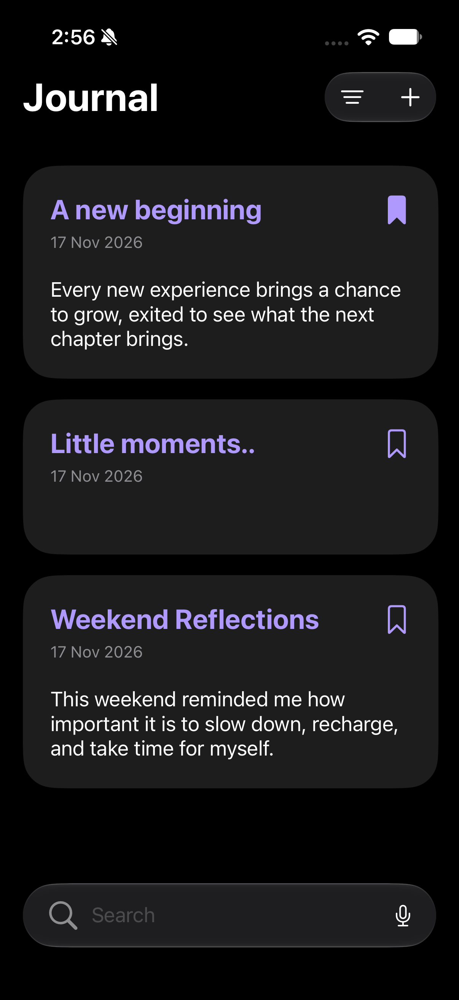
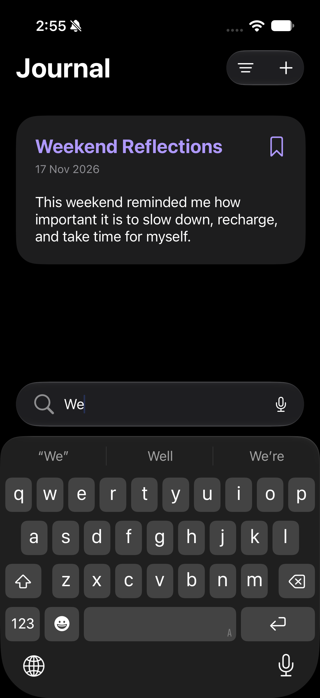

# 📓 Journali

###  Your thoughts, your stories, your space.

A personal journaling experience, designed for you

**Built with SwiftUI for iOS**

---

## 🌙 About Journali

Journali is a personal journaling iOS app designed to make
capturing your thoughts, memories, and experiences simple
and enjoyable.

With a minimal dark interface and elegant purple accents,
Journali provides a peaceful space to write, reflect,
and revisit your favorite moments.

## ✨ Main Features

- 📝 **Create Entries** — Capture your thoughts and memories.
- ✏️ **Edit Entries** — Revisit and update your journals.
- 💾 **Local Storage** — Keep your entries saved on your device.
- 🔍 **Smart Search** — Find journals by title or content.
- 🎙️ **Voice Search** — Search using speech recognition.
- 🔖 **Bookmarks** — Save your favorite entries.
- 📅 **Sorting** — Organize entries by date or bookmarks.
- 🗑️ **Delete Entries** — Remove entries with confirmation.
- 🌙 **Dark Interface** — Minimal design with Liquid Glass elements.

## 🛠️ Technologies

| Technology | Purpose |
|:---:|---|
| 🍎 Swift | Application development |
| 📱 SwiftUI | User interface |
| 🧩 MVVM | Application architecture |
| 💾 UserDefaults | Local data persistence |
| 🎙️ Speech Framework | Speech recognition |
| 🔊 AVFoundation | Audio recording |
| 💻 Xcode | Development and testing |

<h2 align="center"> ✨ A Little Look Inside Journali ✨</h2>

  Your thoughts, your story. 

  
  
  
  
  

  🌸 Welcome &nbsp; • &nbsp;
  ✨ Get Started &nbsp; • &nbsp;
  ✍️ Write &nbsp; • &nbsp;
  📖 Reflect &nbsp; • &nbsp;
  🔍 Rediscover

---

###  Every moment deserves a place to be remembered.

Made with 💜 using SwiftUI.

